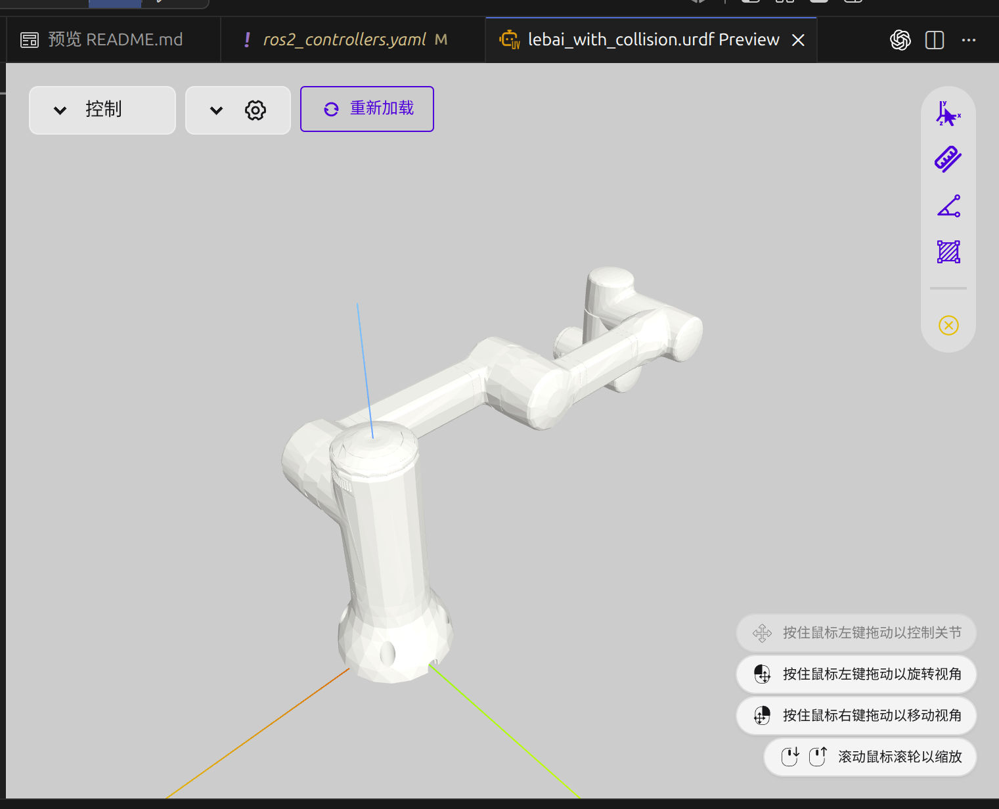
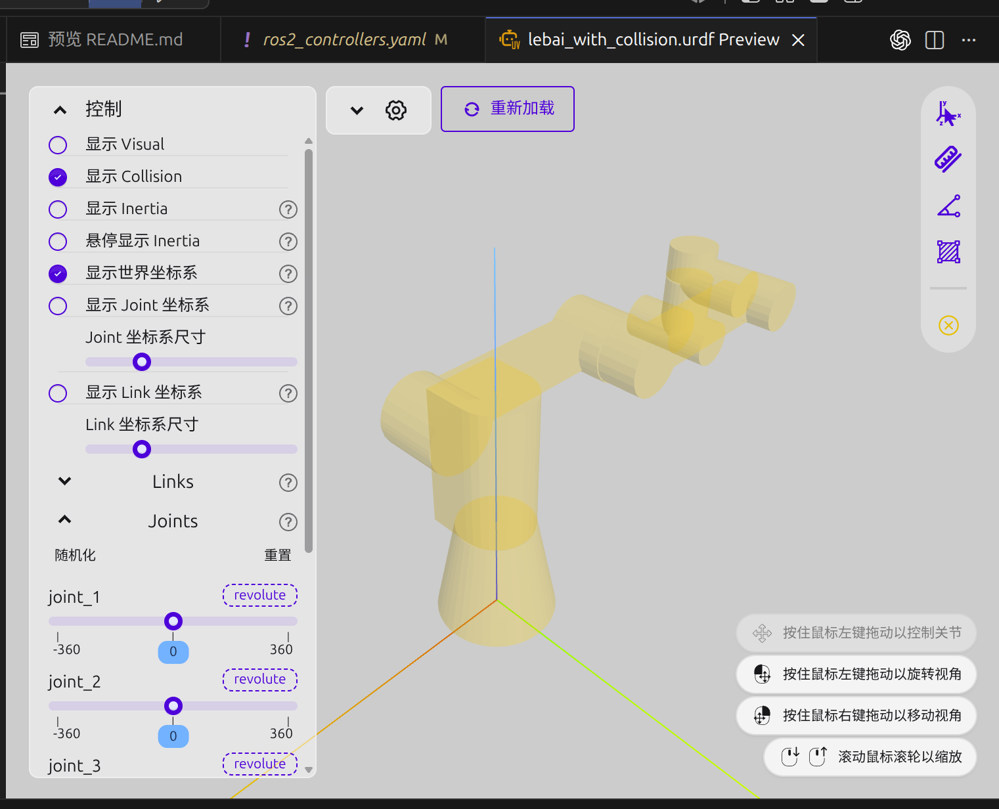
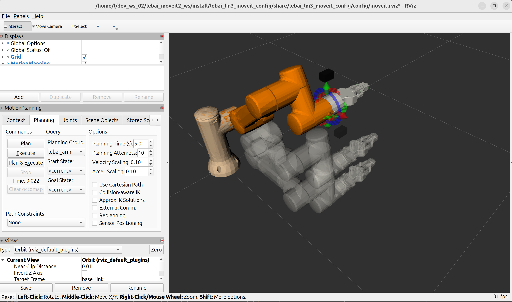

# Lebai LM3：从 URDF、MoveIt 2 到手眼视觉的完整工作区

本仓库以乐白 LM3 六轴机械臂为对象，目标不是只在 RViz 中“显示一个模型”，而是逐步打通下面这条可迁移到真机的链路：

```text
机械结构与碰撞模型
        ↓
URDF / Xacro + TF
        ↓
ros2_control ←→ MoveIt 2 ←→ Gazebo Sim
        ↑                       ↑
  机械臂与夹爪控制        腕部 RGB 相机
                                ↓
                       ArUco 6D 位姿基线
                                ↓
                    world → detected_object
                                ↓
                    规划场景、预抓取与抓取
```

当前开发环境为 Ubuntu 24.04、ROS 2 Jazzy、MoveIt 2 和 Gazebo Harmonic。仓库包含 LM3、平行夹爪、MoveIt 配置、Gazebo 启动、腕部仿真相机，以及独立的真实 UVC 彩色相机 ArUco 位姿估计流程。用户确认相机为奥比中光 Astra Pro Plus；已经实测 `/dev/video0` 能输出 640×480 彩色帧。深度流、真实内参、手眼外参和任意无标记物体识别仍需对应驱动、标定或目标模型，不能从机械臂模型推断。

## 1. 仓库结构

```text
lebai_moveit2_ws/
├── README.md
├── docx/                              # README 使用的效果图
└── src/
    ├── lebai_resources/               # 公共颜色、材料、常量
    ├── lebai_arm_description/         # LM3、组合模型、腕部相机、RViz
    ├── lebai_gripper_description/     # 夹爪模型、mimic、Gazebo 控制
    ├── lebai_lm3_moveit_config/       # SRDF、规划器、控制器、MoveIt launch
    ├── lebai_bringup/                  # mock/Gazebo 的统一启动入口
    ├── lebai_vision/                   # ArUco 检测、PnP、Pose/TF/调试图
    └── lebai_gazebo_lift/              # 预留的抓取应用层包
```

几个关键文件：

- `src/lebai_arm_description/urdf/lm3_macro.xacro`：机械臂几何、惯量、关节和限制。
- `src/lebai_gripper_description/urdf/gripper_macro.xacro`：夹爪几何和联动关系。
- `src/lebai_arm_description/urdf/lm3_with_gripper.xacro`：机械臂、夹爪、相机和 ros2_control 的唯一组合入口。
- `src/lebai_arm_description/urdf/hand_camera.xacro`：可参数化的 eye-in-hand RGB 相机。
- `src/lebai_vision/lebai_vision/aruco_pose_node.py`：视觉 ROS 2 节点。
- `src/lebai_vision/lebai_vision/pose_estimation.py`：与 ROS 解耦、可单测的 PnP 数学代码。

## 2. 环境安装与构建

先安装 ROS 2 Jazzy、MoveIt 2 和 Gazebo Harmonic，再使用 rosdep 补齐仓库声明的依赖：

```bash
cd ~/dev_ws_02/lebai_moveit2_ws
source /opt/ros/jazzy/setup.bash
sudo rosdep init                    # 一台机器只需要执行一次；已初始化则跳过
rosdep update
rosdep install --from-paths src --ignore-src -r -y
colcon build --symlink-install
source install/setup.bash
```

每个新终端都要执行两次 `source`。若本机不是 Jazzy，不应直接照搬 Gazebo 插件名和桥接方式；Jazzy 默认配套的新 Gazebo 与 Gazebo Classic 的插件并不兼容。

构建后的快速检查：

```bash
# 展开组合 Xacro，并检查是否为一棵合法 URDF 树
xacro src/lebai_arm_description/urdf/lm3_with_gripper.xacro > /tmp/lebai_lm3.urdf
check_urdf /tmp/lebai_lm3.urdf

# 视觉数学单元测试
python3 -m pytest -q src/lebai_vision/test
```

## 3. 模型：visual、collision 与 inertial

### 3.1 三者作用不同

- `visual` 只决定 RViz/Gazebo 中“看起来怎样”，可以使用细节完整、面数较高的 STL。
- `collision` 决定 MoveIt 和物理引擎怎样判断碰撞。它应尽量使用低面数凸包、多个简单几何体或凸分解结果。
- `inertial` 决定 Gazebo 中的动力学。质量必须大于零，惯量矩阵应物理合理；视觉模型不能替代惯量数据。

把高面数视觉 STL 原样当碰撞模型，常见后果是碰撞检查慢、规划频繁失败、Gazebo 抖动。相反，把碰撞体缩成极小方块虽然“好像不碰撞了”，实际会让 MoveIt 规划出穿模轨迹。本仓库已恢复夹爪四个连杆的有效碰撞几何。

### 3.2 SolidWorks 导出流程，可以根据你的需要改动(这里忘记保存图片了，下次打开win记得截图)

1. 统一装配体坐标系、关节轴方向和零位；ROS 使用米、弧度、千克。
2. 把每个刚体导出为独立视觉 STL，这里插件本身就是每个link都会导出，确认导出单位，避免毫米模型被按米解释。
3. 单独打开每个零件，然后画简单碰撞体，导出简单碰撞体代替collision里面原本的stl
4. 非凸零件拆成多个凸体；机械臂连杆可优先用胶囊、圆柱和盒体近似。
5. 从 CAD 获取质量、质心和惯量,导出的时候记得检查这些物理性质；注意惯量参考坐标系必须与 `<inertial><origin>` 一致。
6. 导出后先看模型，再做碰撞检查，最后才进入 MoveIt Setup Assistant。

检查工具：

- VS Code 可安装 URDF/Xacro 预览扩展；命令行的 `xacro` 与 `check_urdf` 更适合放入持续集成。还应在 RViz 同时显示 RobotModel 的 Visual Enabled 和 Collision Enabled，检查两套网格是否错位。

最终合理的vision效果图如下：





7. 编写description描述包
[这个ros2的launch描述文件,文件内部结构基本都这样，不同的机械臂的话改路径什么的基本ok](./src/lebai_arm_description/launch/display_lm3.launch.py)

编写功能包过程如下：
```bash
#在有src的目录下
ros2 pkg create lebai_arm_description --build-type ament_python --license Apache-2.0
```
然后把文件结构改成现在的，这个时候应该还不用添加任何的依赖什么的，记得package.xml文件是依赖安装文件，CMakeLists.txt是文件路径安装等有关
启动指令
```bash
ros2 launch lebai_arm_description display_lm3.launch.py
```

机械臂当前效果：


8. 夹爪基本同样的流程
这里不详细赘述
```bash
ros2 launch lebai_gripper_description view_lebai_gripper.launch.py
```


### 3.3 Xacro 组织原则,这里还是很有用的，特别是要叠很多传感器来说

这里也可以看古月居老师的介绍：https://book.guyuehome.com/ROS2/3.%E5%B8%B8%E7%94%A8%E5%B7%A5%E5%85%B7/3.3_URDF/

模型采用“宏定义 + 顶层组合”的方式。`lm3_macro.xacro` 和 `gripper_macro.xacro` 只定义可复用组件，`lm3_with_gripper.xacro` 负责建立唯一的连接关系。夹爪宏本身已经创建 `gripper_mount_joint`，顶层不能再创建第二个 `tool0 → gripper_base_link` 固定关节，否则同一子链接会拥有两个父关节，URDF 不再是一棵树。

夹爪只有 `gripper_r_joint1` 是主动关节，其他关节使用 `<mimic>` 跟随：

```xml
<mimic joint="gripper_r_joint1" multiplier="-1" offset="0"/>
```

`multiplier` 的正负取决于两个关节轴和装配方向，不能机械地全部写成 `-1`。必须在 GUI 中从全开扫到全闭，确认没有反向、越界和自相交。


## 4. MoveIt 2 配置

### 4.1 启动 Setup Assistant

```bash
source /opt/ros/jazzy/setup.bash
source install/setup.bash
ros2 launch moveit_setup_assistant setup_assistant.launch.py
```

建议载入 `lm3_with_gripper.xacro`，并按下面的语义配置：

- Planning Group `lebai_arm`：`base_link → tool0` 的 chain。
- Planning Group `gripper`：主动关节 `gripper_r_joint1`。
- `gripper` 组还应包含五个 mimic 关节，使 RViz 的目标模型显示完整夹爪；MoveIt 仍只有一个主动自由度。
- End Effector `lebai_gripper`：parent link 为 `tool0`，group 为 `gripper`。
- Virtual Joint：`world → base_link`，类型 fixed。
- Group State：机械臂 `initial/home`，夹爪 `open/closed`。

仓库现有 SRDF 已包含上述配置。重新生成配置时不要盲目覆盖手工修改，先用 Git 对比。

### 4.2 主要 YAML 文件

| 文件 | 作用 | 最容易出错的地方 |
|---|---|---|
| `kinematics.yaml` | KDL/其他 IK 求解器 | group 名必须与 SRDF 相同 |
| `joint_limits.yaml` | MoveIt 速度、加速度限制 | 不应超过真机额定值 |
| `ompl_planning.yaml` | OMPL 规划器参数 | 规划器名称与插件要对应 |
| `ros2_controllers.yaml` | controller_manager 加载哪些控制器 | joint 名必须与 URDF 一致 |
| `moveit_controllers.yaml` | MoveIt 把轨迹发给哪个 action | action namespace 必须与控制器一致 |
| `initial_positions.yaml` | mock hardware 初始值 | 应避开自碰撞和奇异位形 |

启动 mock hardware + MoveIt + RViz：
[这里可以跳转查看代码](./src/lebai_bringup/launch/bringup_lebai_lm3_with_gripper.launch.py)

```bash
ros2 launch lebai_bringup bringup_lebai_lm3_with_gripper.launch.py
```

在 RViz 的 MotionPlanning 面板中依次验证：选择 `lebai_arm`、设置随机有效目标、Plan、Execute；再选择 `gripper` 测试 open/closed。选择夹爪组时不要勾选 `Use Cartesian Path`，该选项用于末端笛卡尔路径。夹爪目标模型应当左右两侧一起动；若当前模型未更新，关闭旧 RViz，重建并重新 source。规划成功但执行失败时，优先检查控制器 action 和关节列表。

如果日志停在 `CheckStartStateCollision` 并报告 `gripper_base_link - hand_camera_link` 或 `gripper_base_link - link_6`，说明仍在使用旧组合模型。当前相机安装位姿已避开夹爪底座；固定安装面 `link_6 - gripper_base_link` 在 SRDF 中按相邻组件处理。重新构建、关闭旧进程，在已更新环境的新终端再启动：

```bash
colcon build --symlink-install
source install/setup.bash
ros2 launch lebai_bringup bringup_lebai_lm3_with_gripper.launch.py
```

本次修复用 MoveIt 碰撞检测器检查默认六轴姿态及五个夹爪开度，均为零接触对；还在 mock 控制环境中向 `/move_action` 分别发送只规划的六关节目标和 `tool0` 末端位姿目标，两者均返回 `SUCCEEDED`。拖动的任意末端姿态仍可能超出工作空间或遇到目标碰撞；若新日志提示 IK 无解，应检查目标是否可达，并尝试增大规划时间或改变末端姿态。KDL 的单次 IK 超时现设为 0.1 秒。

在rviz中实现的规划效果：



### 4.3 RRT 不是“越快越好”

- `RRTConnect` 通常适合作为机械臂单次查询的第一基线，收敛快，但路径可能不平滑。
- `RRTstar` 会继续优化路径，通常需要更长规划时间。
- 狭窄空间中可比较 `PRM`、`LBKPIECE` 等，但必须使用同一场景做多次统计。
- OMPL 生成的是几何路径；时间参数化、速度/加速度限制和控制器跟踪是后续环节。

评价规划器至少记录成功率、规划时间、路径长度、最小碰撞距离和执行误差，不能只看一次 RViz 动画。

## 5. Gazebo Sim 与腕部相机

### 5.1 启动

```bash
ros2 launch lebai_bringup sim_lebai_lm3_with_gripper.launch.py
```

该启动文件完成：展开组合 Xacro、启动 Gazebo、生成机器人、启动 `robot_state_publisher`、桥接 `/clock` 和相机信息、用 `ros_gz_image` 桥接图像，以及加载机械臂和夹爪控制器。新 Gazebo 的官方迁移文档也建议图像使用专门的 `ros_gz_image`，CameraInfo 使用 `ros_gz_bridge` 参数文件：[Gazebo Harmonic ROS 2 migration guide](https://gazebosim.org/docs/harmonic/migrating_gazebo_classic_ros2_packages/)。

检查话题：

```bash
ros2 topic list | sort
ros2 topic hz /hand_camera/image_raw
ros2 topic echo /hand_camera/camera_info --once
ros2 run rqt_image_view rqt_image_view /hand_camera/image_raw
```

### 5.2 相机坐标系与安装位姿

模型创建两个 frame：

- `hand_camera_link`：相机实体安装坐标系。
- `hand_camera_optical_frame`：光学坐标系，遵循 x 向右、y 向下、z 向前。

Xacro 中的默认 `camera_xyz="0.04 0.08 0.04"` 和 `camera_rpy="0 -1.57079632679 0"` 只是仿真起点。相机放在夹爪侧面并朝向工具前方，避开底座碰撞几何。真机必须测量/标定 `tool0 → camera`，不要直接使用默认值。相机不一定非要装在手上；若使用固定俯视相机，应把它接到 `world`，视觉节点本身无需修改。

## 6. 视觉与 6D 位姿识别

### 6.1 为什么先实现 ArUco

6D 位姿是三维平移 `(x, y, z)` 加三维旋转。直接上深度学习模型还需要目标 CAD、训练/合成数据、深度相机、GPU、实例分割和模型部署环境；链路中任何一个 TF 或相机内参错误都会被误判成“网络不准”。因此本仓库先使用 ArUco 建立可测量的基线：

```text
Image + CameraInfo
        ↓ detectMarkers
四个亚像素角点
        ↓ SOLVEPNP_IPPE_SQUARE
marker → camera_optical 的 SE(3)
        ↓ 可选 TF（完成外参标定后）
相机坐标系或 world → detected_object
        ↓
PoseStamped + TF + debug image
```

OpenCV 明确指出单个共面方形标记存在位姿二义性，`SOLVEPNP_IPPE_SQUARE` 是方形标记的专用方法；距离远、标记像素太小时应改用 ArUco Board/ChArUco 以增加约束：[OpenCV ArUco FAQ](https://docs.opencv.org/4.x/d1/dcb/tutorial_aruco_faq.html)、[OpenCV marker detection](https://docs.opencv.org/4.x/d5/dae/tutorial_aruco_detection.html)。代码会从两个 IPPE 解中选择相机前方且重投影误差最小的解，并用 `max_reprojection_error` 再过滤一次。

### 6.2 先让当前 USB 相机独立工作

本机 `lsusb` 显示 Orbbec 彩色设备 `2bc5:0511` 和深度设备 `2bc5:0614`，用户确认型号为 Astra Pro Plus。已实测 `/dev/video0` 经 V4L2 可读取 640×480、30 FPS 的彩色图像。这个 UVC 接口**没有提供深度图**；`uvc_camera_node` 只发布彩色图像，内参需要单独标定。这条 RGB 路线可先完成 ArUco 的 6D 验证，无须等待深度驱动。

```bash
source /opt/ros/jazzy/setup.bash
colcon build --symlink-install --packages-select lebai_vision
source install/setup.bash
ros2 run lebai_vision uvc_camera_node
```

另开终端验证 `/camera/color/image_raw` 的 `width: 640`、`height: 480` 和连续消息；可用 `rqt_image_view` 查看画面。未指定标定文件时节点只发布图像，不会捏造 `CameraInfo`，所以位姿节点会明确提示等待内参。

```bash
ros2 topic echo /camera/color/image_raw --field width --once
ros2 run rqt_image_view rqt_image_view /camera/color/image_raw
```

#### 需要深度图时：Astra Pro Plus 官方驱动

奥比中光的 [设备支持表](https://github.com/orbbec/OrbbecSDK_ROS2/blob/main/README.MD) 把 Astra Pro Plus 列在旧版 **`main` 分支**，对应专用启动文件 [`astra_pro_plus.launch.py`](https://github.com/orbbec/OrbbecSDK_ROS2/blob/main/orbbec_camera/launch/astra_pro_plus.launch.py)；`v2-main` 不支持它。不要误用通用 `astra.launch.py`。官方已针对这个型号的 USB 2.0 彩色流配置增加专用启动文件。深度由驱动发布，不能从 `/dev/video0` 的 RGB 帧生成。

在**独立工作区**安装官方驱动，避免把第三方 SDK 及二进制库混入本仓库：

```bash
source /opt/ros/jazzy/setup.bash
mkdir -p ~/orbbec_ws/src
cd ~/orbbec_ws/src
git clone --depth 1 -b main https://github.com/orbbec/OrbbecSDK_ROS2.git
# 本机预检缺少以下两个构建依赖；其他机器按官方 README 检查
sudo apt install nlohmann-json3-dev ros-jazzy-camera-info-manager
cd ~/orbbec_ws/src/OrbbecSDK_ROS2/orbbec_camera/scripts
sudo bash install_udev_rules.sh
sudo udevadm control --reload-rules
sudo udevadm trigger
cd ~/orbbec_ws
colcon build --packages-up-to orbbec_camera --cmake-args -DCMAKE_BUILD_TYPE=Release
source install/setup.bash
ros2 launch orbbec_camera astra_pro_plus.launch.py
```

本机临时克隆的官方驱动已进入构建，首先停在缺少 `camera_info_manager` 开发包；当前工作区**尚未安装或运行深度驱动**。按[官方安装说明](https://github.com/orbbec/OrbbecSDK_ROS2/blob/main/README.MD)补齐依赖与设备规则后，先用 `ros2 topic list | grep camera` 核对实际话题，再检查 `/camera/color/camera_info` 的 `K[0]`、`K[4]` 非零，以及 `/camera/depth/image_raw` 是否连续有帧。驱动与本仓库 UVC 节点不能同时占用相机。使用官方驱动的彩色图像识别 ArUco 时，另开终端运行：

```bash
ros2 launch lebai_vision aruco_pose.launch.py \
  image_topic:=/camera/color/image_raw \
  camera_info_topic:=/camera/color/camera_info \
  marker_size:=0.05 output_frame:=''
```

上述话题是官方驱动的常用默认值；实际以 `ros2 topic list` 为准。正式测量仍应以棋盘和已知距离物体验证相机内参、畸变和位姿误差。

### 6.3 标定彩色相机内参

先生成 9×6 **内角点**、25 mm 方格的 A4 棋盘 SVG，横向打印，缩放设置为 100%，用尺子复测方格边长。如果实测并非 25 mm，把实测值以米传给 `--square-size`。退出正在使用相机的节点，再运行标定程序：

```bash
ros2 run lebai_vision generate_checkerboard --output /tmp/checkerboard.svg
ros2 run lebai_vision calibrate_uvc \
  --device /dev/video0 --cols 9 --rows 6 --square-size 0.025 \
  --samples 20 --output camera_calibration.yaml
```

在窗口中把棋盘移到画面中央、四角、不同距离和倾角；识别出角点后按空格采一帧。程序收集至少 8 帧，默认 20 帧，并拒绝重投影 RMS 大于 1 像素的结果。标定文件与 640×480 图像分辨率绑定；换分辨率必须重新标定。不要同时运行标定程序和 UVC ROS 节点抢占 `/dev/video0`。

### 6.4 识别独立相机中的 6D 位姿

先生成 `DICT_4X4_50`、ID 0 的方形标记并打印，保留白边，禁止适应页面缩放。测量**黑色外框**实际边长，以下示例假定为 0.05 m。把标记固定在待测物体上时，发布的是**标记坐标系的位姿**；只有知道标记到物体坐标系的固定变换，才能换算成物体位姿。

```bash
ros2 run lebai_vision generate_aruco_marker \
  --id 0 --dictionary DICT_4X4_50 --pixels 1000 --output aruco_0.png
ros2 launch lebai_vision uvc_aruco.launch.py \
  calibration_file:=$PWD/camera_calibration.yaml marker_id:=0 marker_size:=0.05
```

接口与验证命令：

| 名称 | 类型 | 含义 |
|---|---|---|
| `/camera/color/image_raw` | `sensor_msgs/Image` | 本机 UVC 彩色图像 |
| `/camera/color/camera_info` | `sensor_msgs/CameraInfo` | 标定内参与畸变；图像和内参时间戳一致 |
| `/object_pose` | `geometry_msgs/PoseStamped` | 标记在 `camera_color_optical_frame` 中的米制 6D 位姿 |
| `/debug_image` | `sensor_msgs/Image` | 检测框及三轴叠图 |
| `camera_color_optical_frame → detected_object` | TF | 与 `object_pose` 一致 |

```bash
ros2 topic echo /camera/color/camera_info --once
ros2 topic echo /object_pose --once
ros2 run rqt_image_view rqt_image_view /debug_image
ros2 run tf2_ros tf2_echo camera_color_optical_frame detected_object
```

若在 RViz 中查看独立相机 TF，把 Fixed Frame 设为 `camera_color_optical_frame`。若无 `/object_pose`，先看是否有 `CameraInfo`、图像能否看到完整黑框和白边、ID/字典是否一致。单标记接近正视、像素太小时可能发生平面姿态翻转；扩大标记或改用板级标记。`marker_size` 写错 10%，距离尺度也会产生近似同量级误差。独立相机流程的 `output_frame` 留空；没有手眼标定时不能输出 `world` 位姿。仿真相机单独用 `ros2 launch lebai_vision aruco_sim.launch.py`，已订阅 `/hand_camera/...` 并使用仿真时间。接入其他真实相机驱动时用 `aruco_pose.launch.py image_topic:=... camera_info_topic:=...`。

### 6.4 从 ArUco 升级到通用物体 6D

视觉节点与下游通过 `PoseStamped + TF` 解耦。后续检测器无论是 FoundationPose、MegaPose、CosyPose，还是 RGB-D 点云配准，都应维持相同输出契约。推荐分层：

1. 实例检测/分割：找出目标和 mask。
2. 6D 推理：结合 RGB、深度、相机内参和 CAD 得到候选位姿。
3. 几何验证：深度一致性、ICP、重投影误差和工作空间过滤。
4. 时间滤波：对平移和旋转分别平滑；物体移动时不能无限平均旧帧。
5. TF 转换：把相机系位姿变换到 `world` 或 `base_link`。
6. 规划场景：把目标及桌面加入 MoveIt PlanningScene，然后生成预抓取位姿。

不要让神经网络节点直接控制机械臂。感知、目标选择、规划和执行之间应有清晰接口，并在执行前检查时间戳、置信度、工作空间、碰撞和急停状态。

## 7. 真机手眼标定

eye-in-hand 的核心是求固定变换 `tool0 → camera_optical_frame`。采集多组差异足够大的机械臂姿态，同时记录 `base → tool0` 和标定板 `camera → target`，再求解经典的 `AX = XB`。仅测一次尺子偏移不能得到可靠旋转。

标定完成后至少做三项验证：

1. 机械臂从多个角度观察静止标定板时，`world → target` 应基本不动。
2. 用独立验证姿态计算平移误差和旋转误差，不要只报告标定集误差。
3. 检查图像时间戳与关节状态同步；机械臂运动时的延迟会表现为空间偏差。

真实相机驱动只需提供标准 `Image` 和 `CameraInfo`，通过启动参数接入，例如：

```bash
ros2 launch lebai_vision aruco_pose.launch.py \
  image_topic:=/your_camera/color/image_raw \
  camera_info_topic:=/your_camera/color/camera_info \
  marker_size:=0.05 output_frame:=''
```

## 8. 从检测位姿到抓取

`lebai_gazebo_lift` 当前只保留应用层包骨架。自动抓取没有被草率补成“收到 Pose 就直线过去”，因为至少还缺少这些真实参数：

- 夹爪 TCP 和抓取中心相对 `tool0` 的变换。
- 目标物几何、桌面位置和 PlanningScene 更新规则。
- 抓取轴、预抓取偏移、闭合宽度、允许接触 link。
- 真机控制接口、速度限制、失败恢复和安全互锁。

正确的抓取状态机建议为：

```text
等待稳定检测 → 冻结目标快照 → 更新规划场景 → 规划预抓取
→ 到达预抓取 → 笛卡尔接近 → 闭合夹爪 → attach object
→ 抬升 → 放置 → detach object → 回到安全位
```

每一步都应有超时、规划失败和控制失败分支。只有在 TCP、手眼标定和场景模型确定后，才适合把这部分接到 MoveIt Task Constructor 或自定义状态机。

## 9. 常见问题

### Xacro 能构建，但 launch 报找不到包

确认先 `source /opt/ros/jazzy/setup.bash`，构建后再 `source install/setup.bash`。仓库过去曾引用不存在的 `lebai_description`，现在统一使用 `lebai_arm_description`。

### RViz 中模型正常，MoveIt 一直报碰撞

打开碰撞模型显示，检查 STL 单位、网格原点和 Allowed Collision Matrix。原始组合模型中相机盒体与夹爪底座重叠，已把相机移到侧面；`link_6` 与夹爪底座的固定安装面则在 SRDF 中声明为相邻组件。如果日志报告其他接触对，应逐对检查实际几何，不能为了让规划通过而删除全部碰撞体。修改后先 `colcon build --symlink-install`，关闭旧 launch 并在重新 `source install/setup.bash` 的终端启动，以免继续使用旧进程中的模型。

### Gazebo 中夹爪不联动

URDF 的五个从动关节均声明 mimic；Gazebo 的 `ros2_control` 只给 `gripper_r_joint1` 命令接口，从动关节只有状态接口。这与 [gz_ros2_control 的 mimic 说明](https://github.com/ros-controls/gz_ros2_control/blob/rolling/doc/index.rst) 一致。独立夹爪 Xacro 和控制器也已统一为该模式。检查展开后的 URDF、`ros2 control list_hardware_interfaces` 和 `/joint_states`；如果真机硬件不支持 mimic，则应在真机硬件层实现映射并重新验证，不能给 mimic 关节同时配置独立命令接口。

### 位姿方向突然翻转

单方形标记在远距离或正视角附近可能出现平面二义性。增大标记在图像中的像素尺寸、改善光照、使用 Board/ChArUco，并结合上一帧连续性选择候选解。

### 位姿平稳但整体有固定偏差

依次检查 marker 实际尺寸、CameraInfo、畸变、`tool0 → camera` 外参和光学 frame 轴约定。固定偏差通常是标定/TF 问题，不是 PnP 随机噪声。

## 10. 当前验证状态与下一步

已完成并在本工作区验证：

- 7 个 ROS 2 包可由 `colcon build --symlink-install` 构建。
- 组合模型和 MoveIt 模型可展开，`check_urdf` 得到合法单根树。
- 夹爪碰撞元素已修复，不再是缺少 `<geometry>` 的无效节点。
- ArUco PnP 使用合成投影做单元测试，平移、四元数和重投影误差检查通过。
- 真实 UVC 相机与 ArUco 节点在本机同时启动；`/dev/video0` 返回 640×480、30 FPS 彩色帧。未取得实物标定板和标记，尚不能声称已验证真实物体 6D 精度。
- 夹爪 SRDF 规划组含六个几何关节，但 MoveIt 计算为一个主动自由度；测试五个开度均联动且无自碰撞。
- `uvc_aruco.launch.py` 参数解析和 Python 语法检查通过；Gazebo 完整运行仍需在本机图形会话中验证。

建议后续按这个顺序推进：

1. 用真实 LM3 关节限制和 CAD 数据复核当前 URDF/惯量。
2. 在本机图形环境中完整跑 Gazebo，相机话题和两个控制器各执行一次。
3. 打印棋盘并完成彩色相机内参标定，再打印标记验证米制 6D 位姿。
4. 完成 eye-in-hand 外参标定和跨姿态验证。
5. 建立桌面/目标 PlanningScene 与 TCP。
6. 再实现 `lebai_gazebo_lift` 的抓取状态机或 MoveIt Task Constructor 任务。

这样推进的好处是每一层都有独立可观测输出：模型看 TF，控制看 action，视觉看重投影和 debug image，抓取看 PlanningScene 与状态机；出现问题时不必在整条系统中盲查。
