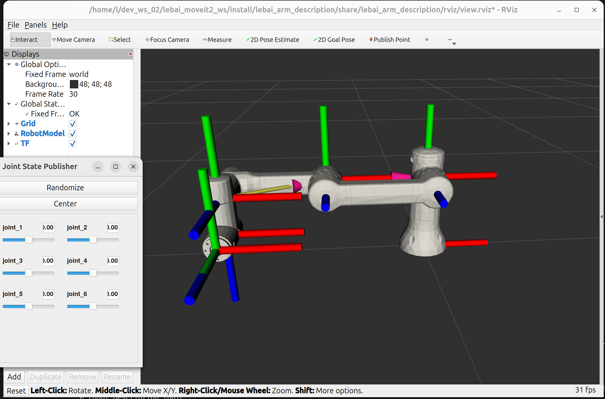
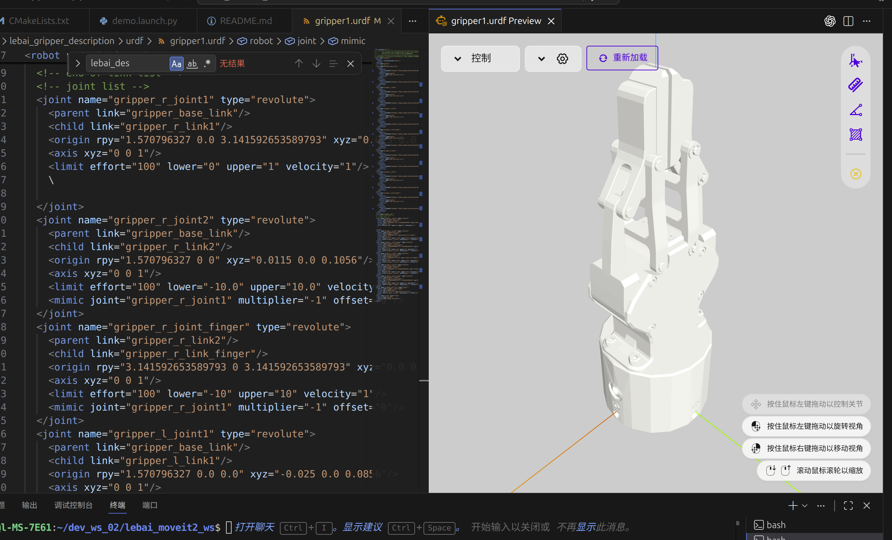
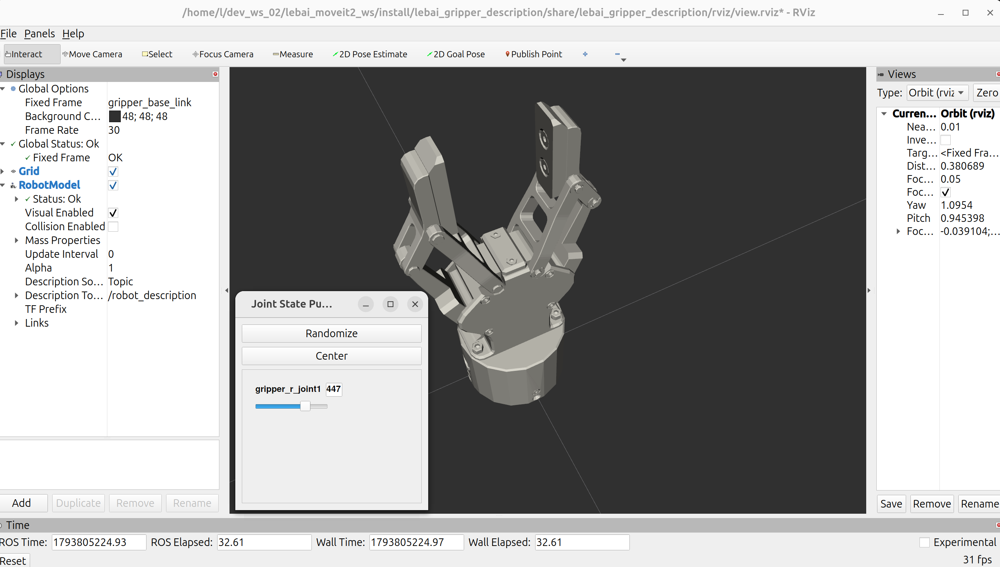

# 如何利用moveit给一款机械臂添加基础配置


## 1.先配置好ros2和moveit_setup_assistant的环境

### 1.文件结构和项目描述

### 2.环境安装

## 2.检查好自己的模型，碰撞模型还是需要重建的

### 1.碰撞模型和视觉模型区别
### 2.怎么用solidworks重建碰撞和导出urdf
### 3.vscode插件检查模型以及网站检查也可以
### 4.怎么写description的launch文件
### 5.机械臂效果图



### 6.夹爪同样的操作，添加mimic参数让夹爪联动

- 核心mimic参数

    你需要在有所关联的关节处添加，这个时候确实vscode插件会很方便你设置这个参数
    ```xml
        <mimic joint="gripper_r_joint1" multiplier="-1" offset="0"/>
    ```
    所以这里是vscode的插件显示图片

    

    夹爪启动launch文件和图片
    [单独启动夹爪launch文件在rviz中的显示代码](./src/lebai_gripper_description/launch/view_lebai_gripper.launch.py)

    
    
## 3.moveit_setup_assistant怎么选配

### 1.指令启动moveit_setup_assistant

### 2.生成的yaml文件介绍

### 3.试验你选择的算法，比如RRT以及算法介绍

## 4.怎么添加到gazebo，怎么加手部相机

## 5.怎么接视觉识别算法，特别是6D位姿识别
